  <picture>
    <source media="(max-width: 640px)" srcset="assets/wordmark-mobile.svg" />
    
  </picture>

  

  

  

  

  
<b>Outros modos do calendário: cobra e borracha</b>

   
  

    
  

  

    
  

 

  

## Projetos em destaque

  
   
  <a href="https://github.com/MaxRbrt/ReciclaPlus">código</a> · <a href="https://maxrbrt.github.io/ReciclaPlus/">demo</a>

  
   
  <a href="https://github.com/MaxRbrt/EduTrack">código</a> · <a href="https://maxrbrt.github.io/EduTrack/">demo</a>

  
   
  <a href="https://github.com/MaxRbrt/TicketFlow">código</a> · <a href="https://projetoticketflow-c3b5c.web.app">demo</a>

 

  

## Contato

  <a href="https://maxrbrt.github.io/Portfolio/"><b>Portfólio</b></a>
  &nbsp;·&nbsp;
  <a href="https://www.linkedin.com/in/marcos-roberto-68310737a/"><b>LinkedIn</b></a>
  &nbsp;·&nbsp;
  <a href="mailto:maxrt3765@gmail.com"><b>E-mail</b></a>

  Painéis SVG gerados a partir dos dados públicos do GitHub e atualizados todo dia por uma GitHub Action.

