  <picture>
    <source media="(max-width: 640px)" srcset="assets/wordmark-mobile.svg" />
    
  </picture>

  

  

  

  <a href="https://maxrbrt.github.io/Portfolio/"><b>Portfólio</b></a>
  &nbsp;·&nbsp;
  <a href="https://www.linkedin.com/in/marcos-roberto-68310737a/"><b>LinkedIn</b></a>
  &nbsp;·&nbsp;
  <a href="mailto:maxrt3765@gmail.com"><b>E-mail</b></a>

